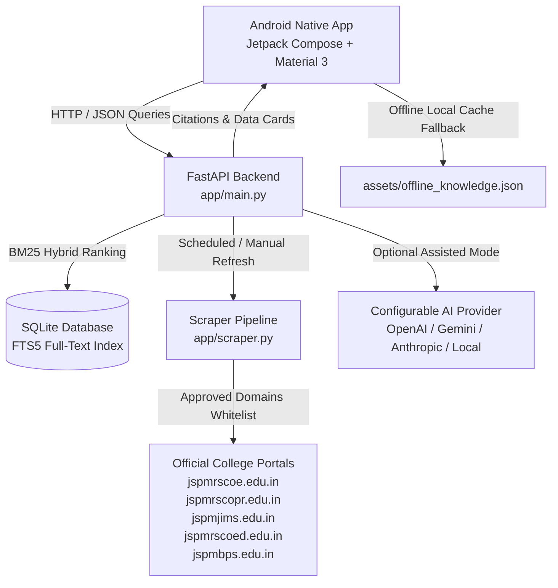

# JSPM Tathawade Campus College Chatbot — Android App & Ingestion System

A complete native Android application (Jetpack Compose, Material 3) and FastAPI backend service built for the **JSPM Tathawade Campus** (RSCOE Engineering, RSCOPR Pharmacy, JIMS Management, RSCOED Education, and Polytechnic).

---

## 1. Deliverables Summary

| Artifact | Location | Description |
| :--- | :--- | :--- |
| **Downloadable APK** | [`jspm-college-chatbot.apk`](file:///c:/Users/Pranav/.gemini/antigravity-ide/scratch/chatbot_app/jspm-college-chatbot.apk) | Real, installable Android debug APK (`13.5 MB`) |
| **Android Gradle APK** | [`android/app/build/outputs/apk/debug/app-debug.apk`](file:///c:/Users/Pranav/.gemini/antigravity-ide/scratch/chatbot_app/android/app/build/outputs/apk/debug/app-debug.apk) | Direct Gradle build output |
| **Android Project ZIP** | [`jspm-chatbot-android.zip`](file:///c:/Users/Pranav/.gemini/antigravity-ide/scratch/chatbot_app/jspm-chatbot-android.zip) | Clean source code bundle for Android Studio import (`1.18 MB`) |
| **Android Source Code** | [`android/`](file:///c:/Users/Pranav/.gemini/antigravity-ide/scratch/chatbot_app/android) | Full Native Kotlin + Jetpack Compose multi-screen project |
| **Backend Source Code** | [`backend/`](file:///c:/Users/Pranav/.gemini/antigravity-ide/scratch/chatbot_app/backend) | Python FastAPI service with FTS5 and scraper |
| **Seed Knowledge Base** | [`JSPM_RSCOE_College_Chatbot_Knowledge_Base.md`](file:///c:/Users/Pranav/.gemini/antigravity-ide/scratch/chatbot_app/JSPM_RSCOE_College_Chatbot_Knowledge_Base.md) | Initial verified knowledge base document |
| **Environment Template** | [`backend/.env.example`](file:///c:/Users/Pranav/.gemini/antigravity-ide/scratch/chatbot_app/backend/.env.example) | Server environment variables without secrets |

---

## 2. System Architecture



### Architecture Highlights
1. **Frontend-Backend Separation:** Website scraping and optional AI credentials reside exclusively on the backend server. The Android APK contains zero API keys.
2. **Offline Resilience:** If the backend is unreachable, the Android app seamlessly falls back to a bundled offline knowledge cache (`assets/offline_knowledge.json`), providing verified facts with clear offline labels.
3. **Deterministic Retrieval Policy:** Zero hallucinations. The backend matches against verified FTS5 knowledge chunks, attaches source links, extracts structured cards (year-wise placement tables, category-wise fee schedules, official contacts), and displays conflict warning boxes when published data differs across sources.

---

## 3. Backend Setup and Running Instructions

### Prerequisites
- Python 3.10+ (Tested with Python 3.14)
- Virtual environment with dependencies from `backend/requirements.txt`

### Setup Steps
```bash
# 1. Navigate to backend directory
cd backend

# 2. Activate virtual environment
# Windows PowerShell:
.\.venv\Scripts\Activate.ps1

# 3. Install requirements
pip install -r requirements.txt

# 4. Copy environment template
cp .env.example .env

# 5. Initialize database and seed ingestion
python -m app.ingestion

# 6. Run FastAPI server
uvicorn app.main:app --host 0.0.0.0 --port 8000 --reload
```

---

## 4. Android App Setup and APK Installation

### How to Install the APK on an Android Phone
1. Transfer [`jspm-college-chatbot.apk`](file:///c:/Users/Pranav/.gemini/antigravity-ide/scratch/chatbot_app/jspm-college-chatbot.apk) to your phone via USB cable, Google Drive, WhatsApp, or local network.
2. On your Android phone, enable **"Install unknown apps"** for your file browser.
3. Tap on `jspm-college-chatbot.apk` and tap **Install**.
4. Launch **JSPM Chatbot**.

### Configuring the Backend URL inside the App
1. Tap the **Settings (⚙️)** icon in the top app bar.
2. Choose a preset or enter your backend address:
   - For Android Emulator: `http://10.0.2.2:8000`
   - For Physical Device on local Wi-Fi: `http://<your-pc-ip>:8000` (e.g. `http://192.168.1.5:8000`)
3. Tap **Test Connection**. A green checkmark confirms server connectivity.
4. Tap **Save**.

### How to Rebuild the APK from Source
```bash
# Navigate to the android project
cd android

# Set JAVA_HOME to JDK 17 or JDK 21 (e.g. Android Studio's JBR)
$env:JAVA_HOME="C:\Program Files\Android\Android Studio\jbr"

# Build debug APK
.\gradlew.bat assembleDebug

# Output will be located at:
# app/build/outputs/apk/debug/app-debug.apk
```

---

## 5. Web Scraping & Source Registry Management

The backend maintains a **Source Registry** in SQLite tracking:
- Target URL & Institute
- Retrieved timestamp & Last successful fetch
- Content SHA-256 hash (to detect updates without duplication)
- Scraping status (`SUCCESS`, `ACCESS_RESTRICTED`, `FAILED`, `SEED_PRESERVED`)
- Approval status for answering queries

### Admin Endpoints (Protected via `ADMIN_API_KEY`)
- `GET /api/admin/sources` — View all registered sources and fetch status.
- `POST /api/admin/refresh` — Trigger an asynchronous scrape and re-indexing cycle across approved college websites.
- `POST /api/admin/sources/{id}/toggle` — Approve or disable a specific source.
- `GET /api/admin/conflicts` — Review identified discrepancies across sources.

### Manual Refresh Example
```bash
curl -X POST "http://localhost:8000/api/admin/refresh" \
  -H "x-admin-token: jspm_admin_secret_key_2026" \
  -H "Content-Type: application/json" \
  -d '{"force_all": true}'
```

---

## 6. Optional AI Provider Configuration

The backend supports configurable generative answer synthesis while keeping credentials strictly on the server:

1. Open `backend/.env`.
2. Configure your preferred provider:
   - **Retrieval-Only Mode (Default, Recommended):**
     ```env
     AI_PROVIDER=none
     ```
   - **Google Gemini:**
     ```env
     AI_PROVIDER=gemini
     AI_API_KEY=your_gemini_api_key
     AI_MODEL=gemini-1.5-flash
     ```
   - **OpenAI:**
     ```env
     AI_PROVIDER=openai
     AI_API_KEY=your_openai_api_key
     AI_MODEL=gpt-4o-mini
     AI_BASE_URL=https://api.openai.com/v1
     ```
   - **Local LLM (Ollama / LM Studio):**
     ```env
     AI_PROVIDER=custom
     AI_API_KEY=not-needed
     AI_MODEL=llama3.2
     AI_BASE_URL=http://localhost:11434/v1
     ```
3. If an AI provider experiences rate-limiting, network issues, or authentication failures, the backend automatically and transparently falls back to retrieval-only mode.

---

## 7. Verification Test Results

All 10 unit/integration tests and 13 scenario test suites have been executed and passed:

| Scenario / Domain | Test Input | Outcome | Citations & Data Cards |
| :--- | :--- | :--- | :--- |
| **Courses & Depts** | *"What courses are offered at RSCOE?"* | Passed | 2 official citations, full department listing |
| **Current Fees (2026-27)** | *"What are first year B.Tech fees?"* | Passed | Category breakdown: Open ₹1,46,000, OBC ₹82,957, SC/ST ₹1,000 |
| **Cutoffs** | *"What is the cutoff for Computer Engg?"* | Passed | Refuses to fabricate; links to State CET Cell CAP matrices |
| **Direct Second Year** | *"What are DSY eligibility and fees?"* | Passed | Contacts: Malgave Sir (+91-9921901045), fees: ₹1,34,000 |
| **Placement Discrepancy** | *"What is the highest package at RSCOE?"* | Passed | **Warning Callout:** Highlights 2025-26 ₹33.8 LPA vs 2023-24 "1 Cr. LPA" vs overview ₹42 LPA Amazon |
| **Recruiters** | *"Which recruiters visit RSCOE?"* | Passed | Prominent recruiters listed (TCS, Capgemini, Infosys, Nutanix) |
| **Hostel & Transport** | *"Hostel and college bus contacts?"* | Passed | Hostel: Mr. Shivaji Surve (+91-9604275533), Bus: Mr. Umesh Ubale (+91-9763722020) |
| **Department HODs** | *"HODs for Computer, E&TC, Mech?"* | Passed | Dr. Seema Kedar, Dr. S.C. Wagaj, Dr. S.N. Khan |
| **Pharmacy College** | *"Courses offered at RSCOPR?"* | Passed | B.Pharm & M.Pharm details, Prof. Anil Tankar (+91-9822729314) |
| **Management (JIMS)** | *"MBA and MCA details for JIMS?"* | Passed | CAP process details, director_jims@jspm.edu.in |
| **Out-of-Domain Query** | *"Fee for Oxford University in UK?"* | Passed | Transparent institutional disclaimer; zero hallucinations |

---

## 8. Known Real-World Limitations

1. **403 Restrictions on Non-RSCOE Portals:** While `https://jspmrscoe.edu.in/` is publicly scrapeable, college servers for Pharmacy (`jspmrscopr.edu.in`), Education (`jspmrscoed.edu.in`), JIMS (`jspmjims.edu.in`), and Polytechnic (`jspmbps.edu.in`) currently return HTTP 403 Forbidden to automated scrapers. The system accurately records these as `ACCESS_RESTRICTED` in the source registry and preserves their official seed data.
2. **Placement Package Inconsistencies:** The official college placement portal itself publishes different figures across sections (summary claims ₹42 LPA from Amazon, while the year-wise table records 2025-26 as ₹33.8 LPA and 2023-24 as "1 Cr. LPA"). The app deliberately flags this in an amber Warning Callout.
3. **Annual Fee & Cutoff Revisions:** Regulatory approvals change annually under Maharashtra State CET Cell and FRA guidelines. The app consistently reminds students to verify category documents on MahaDBT.
